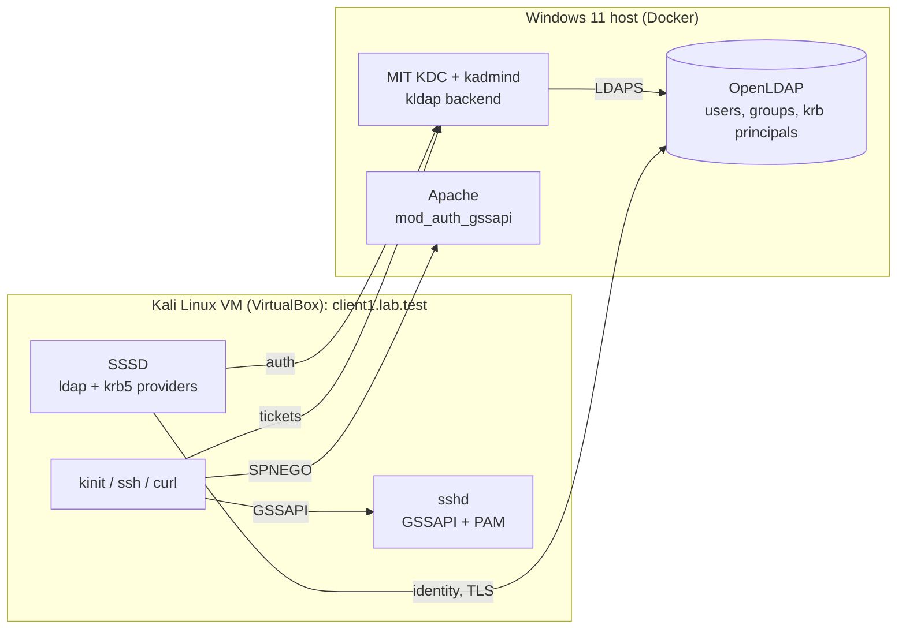
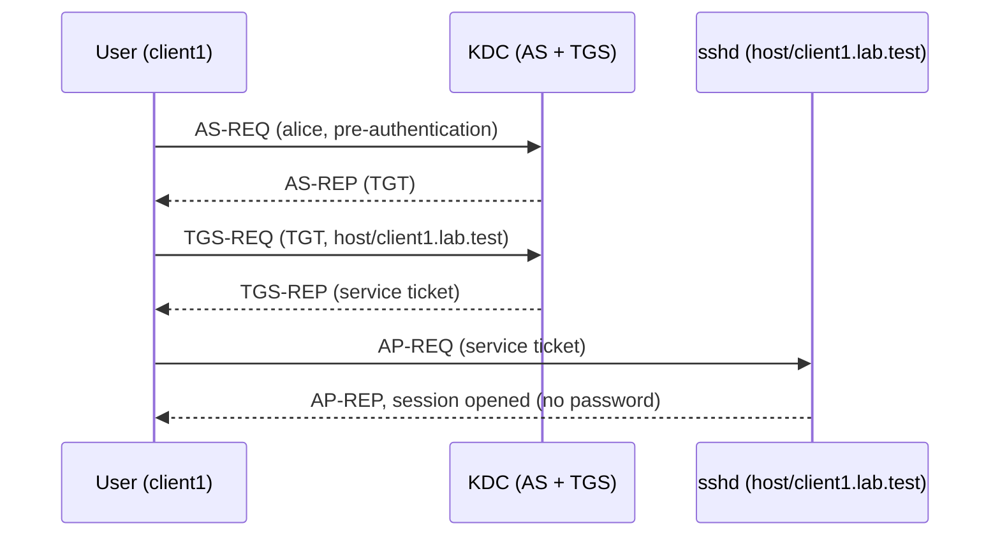
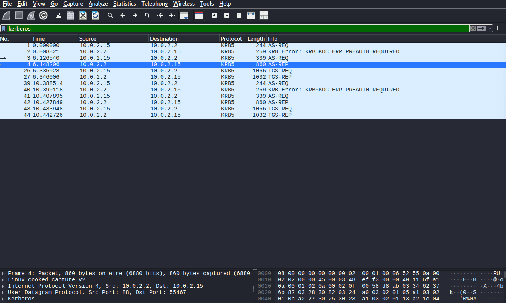
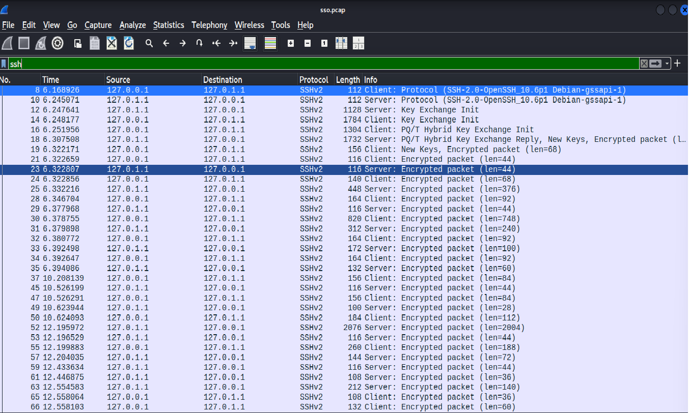

# Kerberos Single Sign-On Backed by LDAP

A self-contained lab that implements **centralized authentication and authorization** with **MIT Kerberos** and **OpenLDAP**. Users and Kerberos principals live in a single LDAP directory, a Linux client resolves them through **SSSD**, and a user who obtains one Kerberos ticket can log in over **SSH** and reach an **Apache** site without typing a password again.

> **Scope:** this is an educational lab built to demonstrate IAM/PAM concepts. It is not a production deployment.

---

## Table of contents

1. [Overview](#1-overview)
2. [Architecture](#2-architecture)
3. [How authentication works](#3-how-authentication-works)
4. [Components](#4-components)
5. [Security design](#5-security-design)
6. [Authorization model](#6-authorization-model)
7. [Repository layout](#7-repository-layout)
8. [Prerequisites](#8-prerequisites)
9. [Quick start](#9-quick-start)
10. [Test suite](#10-test-suite)
11. [Packet capture](#11-packet-capture)
12. [Limitations](#12-limitations)
13. [References](#13-references)

---

## 1. Overview

### The problem

In a typical environment, every server keeps its own local accounts and passwords. Credentials are duplicated across machines, there is no single place to disable a departed user, passwords travel over the network on every login, and access policy is inconsistent from one machine to the next.

### The solution

This project centralizes the three pillars of identity and access management:

| Pillar | Question | Provided by |
|---|---|---|
| **Authentication** | Who are you? | MIT Kerberos (ticket-based, no password sent on the wire) |
| **Identity** | What do we know about you? | OpenLDAP (users, groups, POSIX attributes) |
| **Authorization** | What are you allowed to do? | LDAP groups enforced by SSSD, `sudo` and Apache |

The pieces fit together as follows:

- **One directory, one source of truth.** The Kerberos KDC stores its principals *inside* OpenLDAP (the LDAP database backend), so each user is a single directory entry that carries both identity and credentials. There is no second user list to keep in sync.
- **Linux sees directory users as local users.** SSSD on the client queries LDAP for identity and the KDC for authentication, so `id`, `getent` and PAM logins work for users that do not exist in `/etc/passwd`.
- **Sign in once, reach everything.** After a single `kinit`, the user opens an SSH session and an Apache page with no further prompt.
- **Access is decided by group membership.** Having a valid ticket is not enough: groups in LDAP determine who may log in, who may use `sudo`, and who may open the website (cf. [section 6](#6-authorization-model)).
- **Secure by default for a lab.** LDAP traffic is encrypted, directory access follows least privilege, and no secret is committed to the repository (cf. [section 5](#5-security-design)).
- **Proven by tests.** An automated suite checks successful and failing scenarios (cf. [section 10](#10-test-suite)).

---

## 2. Architecture

The lab is split across two machines, as in a real deployment: a **server side** running the identity services, and a **client side** consuming them.

| Side | Machine | Runs |
|---|---|---|
| Server | Windows 11 host | Docker containers: OpenLDAP, MIT KDC with its administration service, Apache |
| Client | Kali Linux VM (VirtualBox) | SSSD, SSH server, Kerberos client tools |

Each component is described in [section 4](#4-components).

### Naming

| Item | Value |
|---|---|
| DNS domain | `lab.test` |
| Kerberos realm | `LAB.TEST` |
| LDAP base DN | `dc=lab,dc=test` |
| Hostnames | `ldap.lab.test`, `kdc.lab.test`, `web.lab.test` (server side), `client1.lab.test` (the VM) |

The `.test` top-level domain is reserved for testing (RFC 6761). `.local` is deliberately avoided because it conflicts with mDNS.

### Name resolution

The containers publish their service ports on the Windows host. The VM reaches them over the virtual network shared with the host, and the lab hostnames are resolved through entries in the VM's hosts file, pointing the server names to the host. Kerberos is configured not to canonicalize or reverse-resolve hostnames, and clients always connect using the **FQDN**, because a service ticket is only valid for the exact service principal name it was issued for.

### Published ports

| Service | Port(s) |
|---|---|
| KDC | 88 (TCP/UDP) |
| kadmin / kpasswd | 749 (TCP), 464 (TCP/UDP) |
| LDAP / LDAPS | 389 / 636 |
| Apache | 80 |

### Component diagram



---

## 3. How authentication works

Kerberos is a ticket-based protocol. The user proves their identity to the KDC once and receives a Ticket Granting Ticket (TGT). The TGT is then used to obtain a service ticket for each service, without ever typing the password again.



| Exchange | What it achieves |
|---|---|
| **AS-REQ / AS-REP** | The client proves knowledge of the password through encrypted pre-authentication and receives a TGT. The password itself never crosses the network. |
| **TGS-REQ / TGS-REP** | The client presents the TGT and receives a ticket for one specific service, encrypted with that service's key. |
| **AP-REQ / AP-REP** | The client presents the service ticket. The service decrypts it with its keytab and grants access. |

### Two login paths on the client

1. **Ticket-based (SSO):** the user already holds a TGT, so SSH uses GSSAPI and no password is requested.
2. **Password-based:** a console or SSH password login goes through PAM. SSSD checks the password against the KDC and obtains a TGT for the user.

In both cases the account must also pass the access check described in [section 6](#6-authorization-model).

---

## 4. Components

### 4.1 OpenLDAP

OpenLDAP is the directory and the single source of truth. It holds the user accounts with their POSIX attributes (UID, GID, home directory, shell), the groups that drive authorization, a small set of service accounts, and the Kerberos realm data used by the KDC. Each user is represented by one entry that combines identity attributes and a Kerberos principal. The directory is extended with the Kerberos schema so that principals can be stored natively. It is reached over an encrypted connection and is protected by access rules (cf. [section 5](#5-security-design)).

### 4.2 MIT Kerberos KDC

The Key Distribution Center issues and validates tickets for the realm. It runs with the LDAP backend, so principals are created in and read from OpenLDAP rather than from a local database file. Two separate processes are involved: the KDC proper, which answers ticket requests, and the administration service, which creates and modifies principals. Each connects to the directory with its own dedicated service account holding only the permissions it needs. Compared with a standalone Kerberos database, this design avoids duplicate user lists and lets directory access rules cover Kerberos data too.

### 4.3 Client with SSSD

The Kali VM is the Linux client. SSSD links it to the central services: identity requests go to LDAP, authentication requests go to the KDC, and the result is exposed to the system through the name-service switch and PAM. As a consequence, directory users appear as ordinary users in `id` and `getent`, can log in with a password through PAM, and get a home directory created on first login. SSSD also enforces the group-based login restriction (cf. [section 6](#6-authorization-model)) and uses a read-only directory account for its lookups.

### 4.4 SSH with GSSAPI

The SSH server on the client accepts Kerberos tickets in place of passwords. It authenticates itself with a host key stored in a keytab, which lets it decrypt the service tickets presented by users. A user who already holds a ticket connects without any prompt, as shown in the exchange in [section 3](#3-how-authentication-works). Users without a ticket fall back to the PAM-based password path.

### 4.5 Apache web SSO

The Apache container protects a web location with Kerberos through `mod_auth_gssapi`. A browser or `curl` presents an SPNEGO token, which Apache validates with its own service keytab to identify the user. Requests without a valid ticket receive a `401` response inviting the client to negotiate. Only members of the web access group are allowed through (cf. [section 6](#6-authorization-model)).

### 4.6 Lab CA and certificates

A small private certificate authority is generated by a script. It issues the LDAP server certificate, including the correct subject alternative name, and its certificate is trusted by the client and the KDC. The CA key and all issued keys stay out of version control.

---

## 5. Security design

| Measure | What it provides |
|---|---|
| **TLS for LDAP** | Directory traffic, which includes identity data, is encrypted. SSSD and the KDC both validate the server certificate against the lab CA. |
| **Least privilege** | Each account has only the access it needs (table below). Anonymous access is disabled. |
| **No passwords in the directory** | Users have no stored password attribute. Kerberos is the only authenticator, and Kerberos keys are readable only by the KDC service accounts. Compromising the read-only SSSD account exposes no credential material. |
| **Secrets hygiene** | `.env.example` is committed while `.env` is git-ignored. Keytabs, the KDC stash file and private keys are generated at setup time, stored with restrictive permissions, and excluded from Git. |

### LDAP accounts and access rules

| Account | Used by | Permissions |
|---|---|---|
| Directory admin | Provisioning only | Full access |
| SSSD read-only account | SSSD on the client | Read people and groups only. No access to Kerberos attributes and no write access. |
| KDC service account | KDC process | Read access to Kerberos data, with limited write for ticket-related attributes |
| Admin service account | Administration service | Read and write on Kerberos data |
| Anonymous | Nobody | Denied |

These rules are defined in the ACL file under `configs/ldap/`.

---

## 6. Authorization model

Authentication proves identity; **authorization decides what that identity may do.** This project enforces it in three independent places, all driven by LDAP groups.

| Group | Grants | Enforced by |
|---|---|---|
| `ssh-users` | Permission to log in to the client | SSSD access control |
| `admins` | Administrative rights through `sudo` | A sudoers rule on the group |
| `web-users` | Permission to open the protected website | Apache group check |

### Example users

| User | Groups | Expected behavior |
|---|---|---|
| `alice` | `ssh-users`, `admins`, `web-users` | Can log in, use `sudo` and open the site |
| `bob` | `ssh-users`, `web-users` | Can log in and open the site, but cannot use `sudo` |
| `carol` | none | Valid Kerberos principal, but **denied** SSH access despite holding a valid ticket |

The `carol` case is the key one: it shows that a valid ticket does not by itself grant access, and that identity and authorization are separate concerns.

---

## 7. Repository layout

```
kerberos-ldap-sso/
├── docker-compose.yml          Defines the ldap, kdc and web containers
├── .env.example                Template for environment variables and passwords
├── .gitignore                  Excludes .env, keytabs, keys and stash files
├── Makefile                    Entry point for all common tasks
├── README.md
├── configs/
│   ├── ldap/                   Kerberos schema, base, users, groups and ACL LDIF files
│   ├── kdc/                    Kerberos configuration and entrypoint
│   ├── apache/                 Site configuration and entrypoint
│   └── client/                 SSSD, SSH, Kerberos and sudoers configuration
├── scripts/
│   ├── gen-certs.sh            Creates the lab CA and the LDAP server certificate
│   ├── provision-principals.sh Creates principals and links them to LDAP entries
│   └── setup-client.sh         Configures the Kali VM as the Linux client
├── tests/
│   ├── run-all.sh              Runs every client-side test and prints a summary
│   └── ...                     Individual test scripts
└── docs/
    └── img/                    Screenshots used in this README
```

---

## 8. Prerequisites

| Requirement | Where | Notes |
|---|---|---|
| Windows 11 | Host machine | Runs the server side and VirtualBox |
| Docker 29.8 | Windows host | With the Compose plugin |
| VirtualBox | Windows host | Hosts the client VM |
| Kali Linux VM | VirtualBox | Network mode must let the VM reach the host's published ports |
| Git Bash | Windows host | Shell used for all host-side commands; provides `bash` and `openssl` |
| `make` | Windows host and VM | Runs the Makefile targets (installed separately on the Windows host) |
| `bash`, `openssl` | Kali VM | Setup scripts and certificate generation |
| Free ports | Windows host | 88, 464, 749, 389, 636 and 80 (adjustable in `.env`), allowed through the host firewall for the VM |

**Tested on:** Windows 11 host, Kali Linux virtual machine, Docker 29.8.

---

## 9. Quick start

### On the Windows host (server side)

Run these commands in Git Bash.

```bash
# 1. Get the code
git clone https://github.com/<your-user>/kerberos-ldap-sso.git
cd kerberos-ldap-sso

# 2. Create your local configuration
cp .env.example .env
#    edit .env: set the lab passwords and the address at which the VM reaches the host

# 3. Generate the lab CA and certificates
make certs

# 4. Start LDAP, the KDC and Apache
make up

# 5. Create principals from the LDAP users
make provision
```

### On the Kali VM (client side)

Copy the generated CA certificate from the host to the VM, then:

```bash
# 6. Get the code and reuse the same .env values
git clone https://github.com/<your-user>/kerberos-ldap-sso.git
cd kerberos-ldap-sso

# 7. Add the lab hostnames to the VM's hosts file
make hosts

# 8. Configure SSSD, SSH, Kerberos and sudo
make client

# 9. Run the verification suite
make test
```

### Make targets

| Target | Run on | Action |
|---|---|---|
| `make certs` | Host | Generate the CA and server certificates |
| `make up` | Host | Build and start the Docker services |
| `make provision` | Host | Load LDIF data, create the realm, create and link principals |
| `make check-kdc-log` | Host | Verify that failed logins are recorded in the KDC log |
| `make down` | Host | Stop the services |
| `make clean` | Host | Remove containers, volumes and generated secrets |
| `make hosts` | VM | Add the lab hostnames to the hosts file |
| `make client` | VM | Configure SSSD, SSH, Kerberos and sudo, and obtain the client's host keytab |
| `make test` | VM | Run the end-to-end test suite |

---

## 10. Test suite

```bash
make test
```

`tests/run-all.sh` runs on the client, executes every check, prints PASS or FAIL for each, and exits non-zero if any fails. The one check that needs the KDC's own log runs on the host with `make check-kdc-log`.

### Positive tests

| Test | Expectation |
|---|---|
| Ticket acquisition | `kinit` succeeds and `klist` shows a TGT for `alice@LAB.TEST` |
| Identity resolution | `id alice` and `getent passwd alice` return LDAP-backed data with the correct groups |
| Passwordless SSH | After `kinit`, SSH to `client1.lab.test` works without a prompt |
| Web SSO | `curl --negotiate` returns HTTP 200 |
| Privilege escalation | `alice` can run `sudo` |

### Negative tests

| Test | Expectation |
|---|---|
| Wrong password | `kinit` fails, and the KDC log records the pre-authentication failure (`make check-kdc-log`) |
| Unauthorized user | `carol` is refused by SSH even with a valid ticket |
| Wrong service name | Connecting with a name other than the service's FQDN makes GSSAPI fail |
| Destroyed ticket | After `kdestroy`, passwordless SSH no longer works |
| Clock skew | With the VM's clock shifted by more than five minutes, `kinit` fails with `Clock skew too great` |
| No ticket on the web | `curl` without credentials receives HTTP 401 |
| Non-admin sudo | `bob` cannot use `sudo` |

### Security checks

| Test | Expectation |
|---|---|
| Anonymous LDAP access | An unauthenticated search is refused |
| Read-only account | The SSSD account cannot write and cannot read Kerberos attributes |
| Certificate validation | The LDAP certificate validates against the lab CA, and a client without the CA fails |

---

## 11. Packet capture

Kerberos traffic captured during an SSH login and opened in Wireshark with the `kerberos` display filter (cf. [section 3](#3-how-authentication-works) for the message sequence).





---

## 12. Limitations

- Single KDC and single LDAP server: no replication or failover.
- Only one client machine, and all server components share one host, so separation between LDAP, KDC and web is logical rather than physical.
- Private CA with manual trust distribution (the CA certificate is copied to the client by hand).
- Secrets are handled through environment files rather than a secrets manager.

---

## 13. References

- MIT Kerberos documentation: <https://web.mit.edu/kerberos/krb5-latest/doc/>
- MIT Kerberos LDAP backend: <https://web.mit.edu/kerberos/krb5-latest/doc/admin/conf_ldap.html>
- OpenLDAP Administrator's Guide: <https://www.openldap.org/doc/admin26/>
- SSSD documentation: <https://sssd.io/docs/>
- `mod_auth_gssapi`: <https://github.com/gssapi/mod_auth_gssapi>
- RFC 4120 (Kerberos V5) and RFC 4511 (LDAP)
